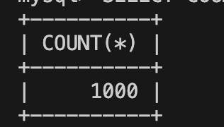
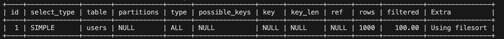
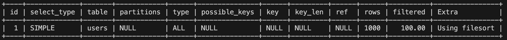
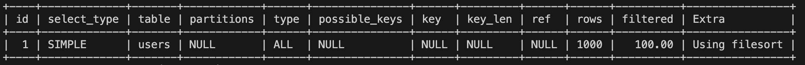
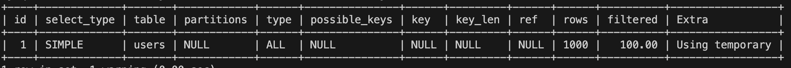
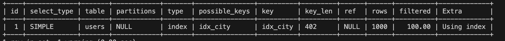

# 🗄️ Отчёт: Ускорение ORDER BY и GROUP BY

> **Дисциплина:** Основы проектирования баз данных
> **Задание:** Изучение механизмов сортировки и группировки, оптимизация запросов с помощью индексов.
> **Дата:** ноябрь 2026

---

## 📑 Содержание

1. [Цель работы](#-цель-работы)
2. [Среда выполнения](#-среда-выполнения)
3. [Ход выполнения](#-ход-выполнения)
   - [1. Создание БД и таблицы](#1-создание-бд-и-таблицы)
   - [2. Оптимизация ORDER BY](#2-оптимизация-order-by)
   - [3. Сортировка по двум полям](#3-сортировка-по-двум-полям)
   - [4. Оптимизация GROUP BY](#4-оптимизация-group-by)
   - [5. Дамп и лог](#5-дамп-и-лог)
4. [Вывод](#-вывод)
5. [Приложения](#-приложения)

---

## 🎯 Цель работы

Понять, как MySQL выполняет `ORDER BY` и `GROUP BY`, научиться выявлять `Using filesort` и `Using temporary` с помощью `EXPLAIN`, а также оптимизировать запросы с помощью создания индексов.

---

## 🛠 Среда выполнения

| Компонент | Версия / Значение |
|-----------|-------------------|
| ОС | macOS (Apple Silicon) |
| Терминал | zsh |
| Docker | Docker Desktop |
| Образ MySQL | `mysql:8.0` → **MySQL Community Server 8.0.46** |
| Кодировка | `utf8mb4` / `utf8mb4_unicode_ci` |

---

## 🚀 Ход выполнения

### 1. Создание БД и таблицы
Создана база `sort_practice` и таблица `users`. С помощью `WITH RECURSIVE` в таблицу было сгенерировано 1000 строк для наглядности работы оптимизатора.

---

### 2. Оптимизация ORDER BY

**До создания индекса:**
Запрос `SELECT * FROM users ORDER BY age;` вызывает полный перебор и сортировку в памяти — `Using filesort`.

**После создания индекса `idx_age`:**
При запросе только индексируемого столбца (`SELECT age FROM users ORDER BY age;`) MySQL использует индекс, `filesort` исчезает, появляется `Using index`.

---

### 3. Сортировка по двум полям

Если сделать сортировку по двум полям (`ORDER BY age, name`), MySQL снова использует `Using filesort`, так как существующий индекс `idx_age` не покрывает столбец `name`.

---

### 4. Оптимизация GROUP BY

**До создания индекса:**
Запрос `GROUP BY city` заставляет MySQL создавать временную таблицу и сортировать её — `Using temporary; Using filesort`.

**После создания индекса `idx_city`:**
СУБД использует индекс для группировки. Временная таблица больше не создается (`Using temporary` исчезает), появляется `Using index`.

---

### 5. Дамп и лог

Сформирован дамп базы данных `sort_dump.sql` и очищенный лог действий `my_actions.log`.

---

## ✅ Вывод

В ходе работы:

1. ✅ Изучен механизм выполнения сортировки (`ORDER BY`) и группировки (`GROUP BY`) в MySQL.
2. ✅ Доказано, что индексы кардинально ускоряют эти операции, избавляя от `Using filesort` и `Using temporary`.
3. ✅ Установлено, что для сортировки по нескольким полям необходим **составной индекс** (текущий `idx_age` не справляется с `ORDER BY age, name`).
4. ✅ Индексирование столбцов группировки позволяет MySQL использовать индекс вместо создания временной таблицы.
5. ✅ Сформированы дамп базы данных и лог действий пользователя.

---

## 📎 Приложения

- 💾 [Дамп БД `sort_practice`](sort_dump.sql)
- 📄 [Лог действий](my_actions.log)
- ⚙️ [Конфиг MySQL](my.cnf)

---

  <i>© 2026</i>

